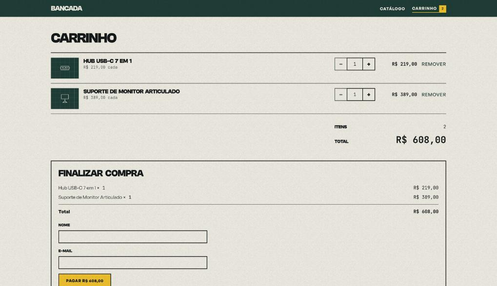
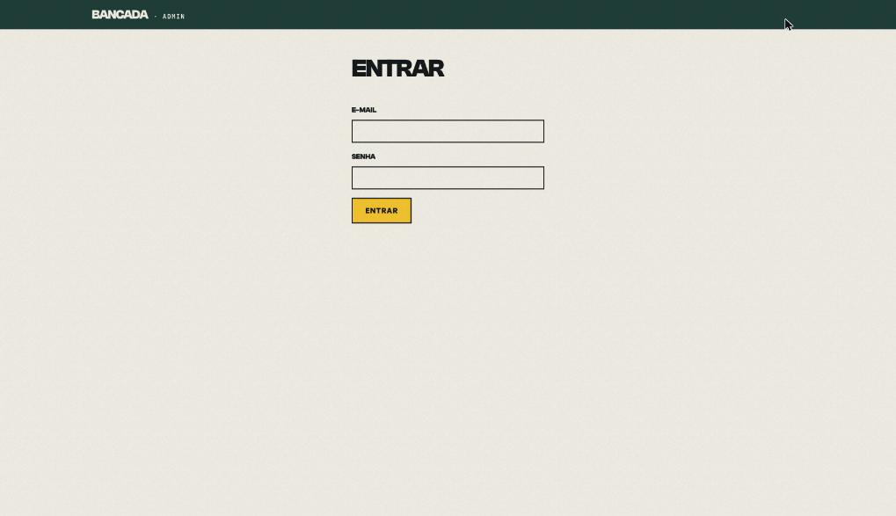
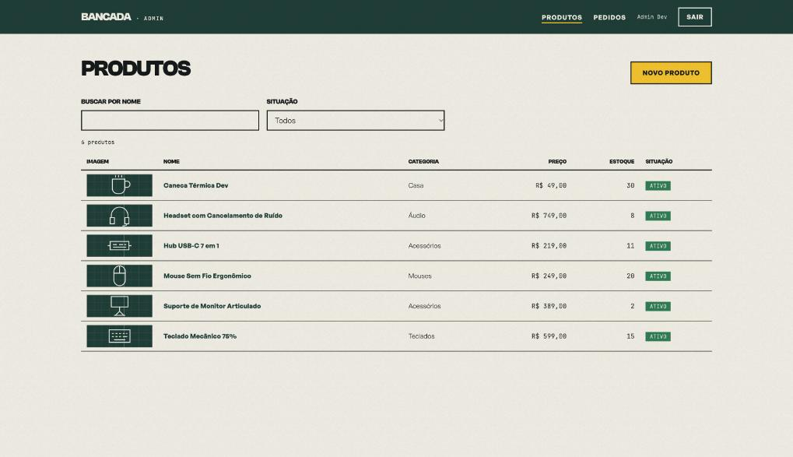
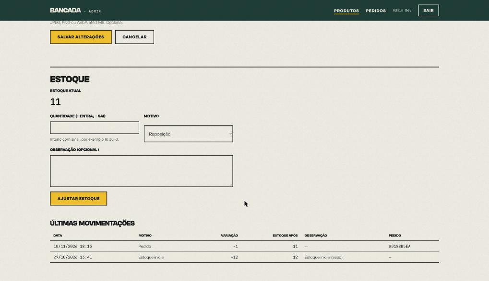

# Bancada

E-commerce full stack de equipamentos para a mesa de trabalho de devs (teclados, mouses, headsets, suportes, hubs, canecas). É um projeto de portfólio: o foco não é o catálogo, e sim o **fluxo de pagamento** e o **controle de estoque** feitos do jeito certo.

O que ele prova, com testes contra um PostgreSQL real:

- **Pedido idempotente**: a mesma `Idempotency-Key` devolve o mesmo pedido; a mesma chave com outro corpo é recusada.
- **Sem venda dupla sob concorrência**: 6 pedidos simultâneos para 3 unidades vendem exatamente 3.
- **Estoque auditável**: todo movimento fica num livro-razão (`stock_movements`), e o estoque atual é sempre a soma dos deltas.
- **Webhook validado e deduplicado**: assinatura conferida, pagamento reconsultado no provedor (o corpo nunca é confiado) e cada evento processado uma única vez.
- **Máquina de estados do pedido** com transições explícitas, e uma **área administrativa** (login por cookie `httpOnly`, CSRF por header, upload direto ao S3).

**Stack:** Node 22 e TypeScript estrito · Express 5, Zod 4, `pg` com SQL puro (sem ORM), Pino · PostgreSQL 16 com migrações `.sql` e runner próprio · SDK oficial do Mercado Pago · S3 (MinIO localmente) · React 19, Vite, React Router 7, TanStack Query 5, Zustand 5, React Hook Form · Jest e Vitest · Docker Compose e GitHub Actions. API, web e o pacote de schemas compartilhados vivem num monorepo de npm workspaces.

**Deploy:** em breve (T23).

**Mercado Pago real:** o código usa o SDK oficial e é testado com um gateway simulado. O teste ponta a ponta com o Mercado Pago de verdade é a tarefa T22 e **ainda não foi feito** (ver [Modo Mercado Pago](#modo-mercado-pago-planejado-ainda-não-verificado)).

## Prints

### Loja

_Catálogo, com selo de estoque baixo e produtos sem imagem mostrando o ícone da categoria._

_Carrinho persistente (sobrevive ao F5); a quantidade nunca passa do estoque._

_Checkout: o botão diz quanto será cobrado, e um duplo clique gera um pedido só._

_Acompanhamento do pedido, que consulta a API a cada 3 s enquanto está pendente e vira "Pago" sozinho._

### Administração

_Login do admin (cookie `httpOnly`; e-mail inexistente e senha errada dão a mesma mensagem)._

_Lista de produtos, com busca por nome e filtro de situação._

_Painel de estoque: ajuste com sinal e o histórico (o livro-razão) das últimas movimentações._

_Pedidos, com filtro por situação; o botão "Cancelar pedido" só aparece quando o servidor diz que é possível._
